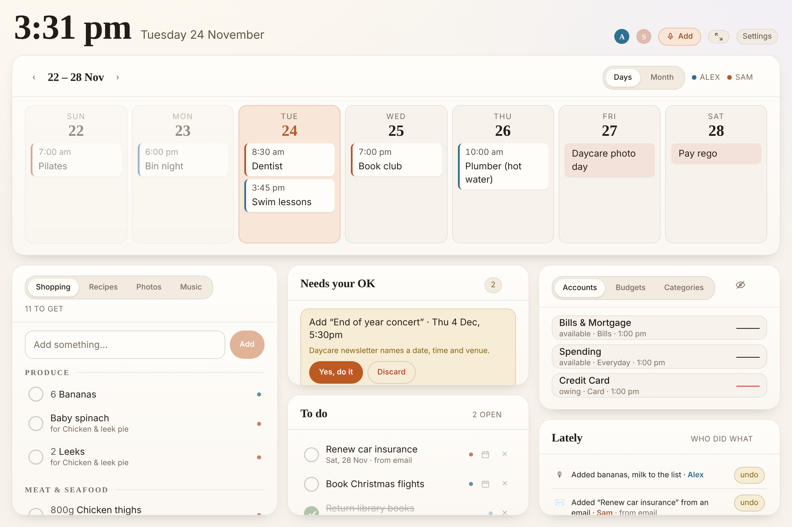
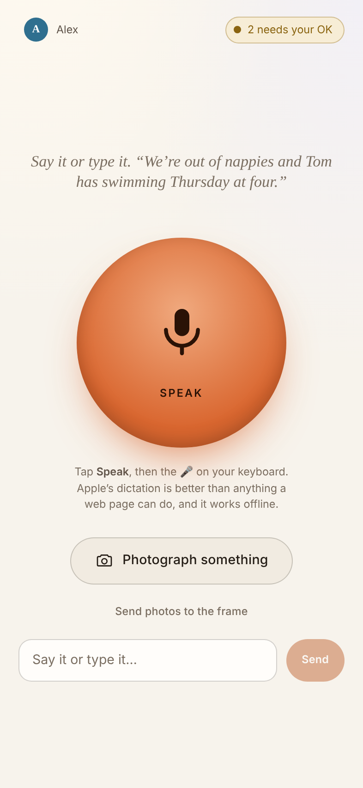
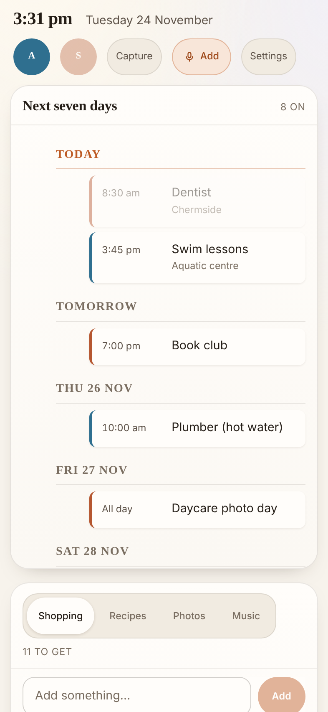

# Household

A coordination app for two people, three screens and one house.



<p>
  
  
</p>

*Screenshots use made-up demo data. Money figures are hidden by default.*

## Why it exists

Two working parents, two phones, two calendars and a pile of school emails.
Things got missed because they lived in one person's head or one person's inbox.

So this is the fix. Say "we're out of nappies and swimming's Thursday at four"
into a phone and it lands on the list and the calendar. Emails get read for
anything dated, and anything Claude isn't sure about waits for a tap rather
than being filed or dropped. The wall in the kitchen shows the lot.

It's built and maintained with Claude Code. `CLAUDE.md` is the most
interesting file in the repo: it records the decisions and, more usefully,
the bugs that looked like nothing was wrong.

- **`/capture`** — a phone. One big microphone, one camera button. Say or
  photograph something and it lands in the right place: a calendar event, a
  shopping item, a reminder, a recipe, a note, a spend.
- **`/today`** — the other half of the phone app, one tap from the capture
  screen. The week as an agenda, the list, and anything waiting on you.
- **`/dashboard`** — the wall-mounted Surface. The week, the list, the recipes,
  the money, anything that needs a look, and who did what. When nobody has
  touched it for a while it turns into a photo frame.
- **`/settings`** — connect each person's Google and Outlook accounts.

Two installable apps, not three. The phone gets one icon holding both
`/capture` and `/today`; the wall gets its own, in landscape and fullscreen.
`/today` and `/dashboard` are the same component under a `variant` — the phone
reading drops the wake lock, the screensaver and the evening dim, all of which
are battery bugs on a device that lives in a pocket, and reads the week as a
list because seven day-columns need more width than a phone has.

## Start here

This is somebody's working house system, handed over. It runs, it is in daily
use, and it is opinionated. Expect to spend an evening on it, most of that
waiting for OAuth consent screens.

### What you need

**Required**

- **Node 20+** and **PostgreSQL 14+**. Postgres can be local, Docker, or
  hosted — it only needs a `DATABASE_URL`.
- **A Claude subscription or an Anthropic API key.** The app cannot parse
  anything without one; see *Two inference backends* below for which to pick.

**Optional, and each one is genuinely optional** — leave the variables unset
and that feature reports itself as not configured instead of breaking:

- Google and/or Microsoft accounts, for calendars and mailbox scanning
- Pocketsmith, for the money tile
- Home Assistant, for cameras and robots
- Spotify, for the music tab
- An always-on machine and a touchscreen, if you want the wall display

**Hardware.** Any always-on machine will do. The original runs on a
wall-mounted Surface, which is why `scripts/` is PowerShell and why there is
so much care about a display with no keyboard. On Linux or a Mac, ignore
`scripts/` entirely and run `npm start` under systemd or launchd.

### Getting Claude Code to work on this repo

The codebase is written to be worked on with Claude Code. `CLAUDE.md` is not
documentation for you — it is the context the model reads first, and it holds
the decisions that are already settled and the reasons behind them. Keep it
current and the model stops re-litigating things.

**On your own machine** (simplest):

```bash
npm install -g @anthropic-ai/claude-code
git clone https://github.com/<you>/household-os-shareable.git
cd household-os-shareable
claude          # it will walk you through signing in
```

Git and GitHub work the way they already do on your machine. Claude Code uses
your existing credentials, so if `git push` works in that directory, so does
Claude Code. If you have never pushed from this machine, set up a GitHub SSH
key or a credential helper first.

**From a browser or phone** (claude.ai/code), which is how the original gets
changed while nobody is at the machine:

1. Sign in at [claude.ai/code](https://claude.ai/code).
2. Connect GitHub: **Settings → Connectors → GitHub**, then authorise the
   Claude GitHub app.
3. Grant it access to this repository specifically. You will be asked to pick
   either all repositories or a chosen list — a chosen list is the better
   habit.
4. Start a session against the repo. It gets a container, clones the code,
   and pushes branches back to GitHub.

If your repo belongs to an organisation rather than to you, an org owner has
to approve the app before step 3 will offer it.

The official docs are at
[code.claude.com/docs](https://code.claude.com/docs/en/claude-code-on-the-web)
and cover the environment settings — network policy, secrets, setup
scripts — in more detail than is worth repeating here.

### Making it yours

```bash
cp .env.example .env.local
```

Open `.env.local` and do these four, in order. Nothing works until they are
done:

1. **`DATABASE_URL`** — your Postgres. The schema builds itself on the first
   request; there is no migration step.
2. **`APP_SECRET`** — any long random string. It signs the passcode cookie and
   the OAuth state. Generate one rather than inventing one:
   `node -e "console.log(require('crypto').randomBytes(32).toString('hex'))"`
3. **`HOUSEHOLD_PROFILES`** — the two people, comma separated, e.g.
   `HOUSEHOLD_PROFILES=Ravi,Jo`. These seed the profiles table on first run
   and become the colours and names in the activity feed. Changing them later
   means editing the `profiles` table, so get them right now.
4. **`HOUSEHOLD_TIMEZONE`** — an IANA name like `Europe/London` or
   `America/Denver`. Every dictated "Thursday at six" is resolved in this
   zone, so a wrong value puts appointments on the wrong day.

Then pick an inference backend. `CLAUDE_BACKEND=api` with an
`ANTHROPIC_API_KEY` is the predictable one and bills per token.
`CLAUDE_BACKEND=cli` shells out to a Claude Code that is already signed in on
that machine, which avoids a key but brings an OAuth session that expires and
has to be renewed by a person at the keyboard. Read the two sections on this
below before choosing; there is a war story attached.

```bash
npm install
npm run dev          # http://localhost:3000
```

Set `HOUSEHOLD_PASSCODE` before you expose this to anything. There are no
per-person logins by design — one shared passcode, entered once per device.
Leave it unset locally and the gate is off, which is what you want while
developing and emphatically not what you want on a URL.

### What to turn off

The dashboard tiles are driven by whichever integrations have credentials, so
the shortest path to something useful is to start with none of them: run it
with just a database and a model, use `/capture` and the calendar, then add
Google, then add whatever else you actually have. Every integration below is
independent of every other.

The parts most likely to be wrong for you:

- **`scripts/*.ps1`** are Windows-specific and exist to make one machine an
  appliance. Delete them if you are not deploying that way.
- **The money tile** assumes Pocketsmith. If you use something else this is
  the tile to rewrite; `src/lib/pocketsmith.ts` is the whole of it.
- **Cameras** assume Home Assistant, and live view assumes a Blink proxy.
  Stills work through Home Assistant alone.
- **The screen-rest window** is 11pm to 5am, which suits a kitchen. It is in
  `scripts/tasks.ps1`.

### A warning worth reading

`CLAUDE.md` has a section called *When something here silently does nothing*.
It was written after a week lost to a mailbox scanner that was working
correctly the entire time, while an expired sign-in was being converted into
a successful empty result. If this system ever appears to do nothing, read
that section before you start debugging. It will save you the week.

## How it fits together

```
phone (voice / photo)  ─┐
                        ├─→  /api/capture  ─→  Claude (tool use + vision)  ─→  tool calls
mailbox scan (cron)    ─┘                                                        │
                                                                                 ▼
                                                       high confidence? ── yes ──→ do it
                                                                │
                                                                no
                                                                ▼
                                                        "Needs your OK" queue
```

The parsing layer is Claude with a fixed set of tools — `add_calendar_event`,
`add_shopping_items`, `add_reminder`, `add_recipe`,
`add_recipe_to_shopping_list`, `log_note`, `log_expense_note`, `no_action` —
shared by the capture flow and the mailbox scanner, so both speak the same
vocabulary and both land in the same activity feed.

Every tool call carries its own `confidence`. High confidence executes
immediately; anything less is parked in the queue with the reason attached.
The bias is deliberate and one-sided: **friction is the thing most likely to
kill this system**, so a plainly stated item goes straight in, and only a guess
that could put a wrong thing in the calendar waits for a human.

## Two inference backends

`CLAUDE_BACKEND` picks how the parsing layer reaches Claude. Everything
downstream is identical — both produce the same tool calls, and `runToolCall`
never knew the difference — so this is one environment variable, not a fork.

| | `api` | `cli` |
| --- | --- | --- |
| How | Messages API, real tool definitions | `claude -p` subprocess on a signed-in machine |
| Arguments | Schema-enforced | JSON asked for in the prompt, then parsed |
| Images | base64 content blocks | written to a temp dir, read off disk |
| Errors | Typed (`429`, `RateLimitError`) | Exit code plus stderr |
| Latency | Model time | Model time plus ~0.5–2s process startup |
| Cost | Per token | Included in a signed-in plan |

**The `cli` backend exists because "same mechanism, no new key" is a real
constraint if you already run a machine signed into Claude Code.** What it
gives up is worth knowing before you rely on it: nothing enforces the output
shape, so malformed JSON is a case to handle rather than an impossibility (it
is stripped of fences, recovered from a preamble, and retried once before
giving up); and a rate limit arrives as an exit code and some text rather than
something you can branch on.

Two details that took finding:

- **The CLI's Read tool can only reach its working directory.** So a photo is
  written into a fresh temp directory which then becomes the CLI's `cwd`, and
  removed afterwards. That is why vision works here at all — not as content
  blocks, but as a file on disk.
- **Killing the CLI does not close its stdout.** Anything it spawned inherits
  the pipe and can hold it open long after the parent is gone, so the timeout
  settles the request itself rather than waiting for the process to close. The
  test asserts the clock, not just the error.

The prose description of the tools that the `cli` backend sends is **generated
from the same `HOUSEHOLD_TOOLS` definitions** the `api` backend hands over as
JSON Schema. Written by hand, the two would drift the first time a field was
added and only one of them learned about it; a test walks every tool and every
field to keep that honest.

Settings shows which backend is live and whether it answers.

## What lives where

| Data | Home | Why |
| --- | --- | --- |
| Shopping list, recipes, reminders, notes, spend notes, queue, activity | Postgres | Ours to own |
| Photos | Postgres, downscaled | One fewer service to hold an account for |
| Cameras | Home Assistant, live | It holds the Blink login, on your hardware |
| Calendar events | Google Calendar, live | It already has an owner, and we both edit it from our phones |
| Account balances, budgets, spending by category | Pocketsmith, read-only, cached 15 min | Same |
| Email | Gmail / Microsoft Graph, read-only | Only the extraction is kept, never the message |

## The photo frame

The dashboard's third tab is a photo library. Add photos there, or send them
from a phone — the capture screen has a separate "Send photos to the frame"
control, deliberately not the same button as the one that photographs a school
flyer, because sending a notice and sending a picture of the baby are different
intentions and no model should have to guess which is which.

Tick photos to choose what shows. **Single** shows one; **Slideshow** cycles
everything ticked, or the whole library if you tick nothing. Both settings live
in Postgres rather than on the device, so choosing a photo from the sofa on
your phone changes what is on the wall.

The screensaver comes up after the chosen idle period and goes away on any
touch. Photos are letterboxed rather than cropped — a blurred copy of the same
photo fills the space either side, so a portrait shot doesn't sit in two black
bars and nobody's head gets cut off. The clock stays on top, so the wall is
still a clock.

Photos are stored in Postgres, downscaled in the browser before upload to
1600px on the long edge with a 320px thumbnail alongside — a few hundred
photos is tens of megabytes, and the picker grid never pulls the full images.
Uploads go one photo per request to stay inside the serverless body limit. If
the library ever grows past a few thousand, that is the point to move the bytes
to object storage; the metadata and the routes would not change.

Deleting is soft — a mis-tap on a wall display shouldn't destroy the only copy
of a photo — and undoable from the activity feed like everything else.

## Cameras

The Cameras tab shows each camera's latest still, its battery, whether it saw
motion and how long ago, and arms or disarms the system. A pill in the header
carries the armed state so you can see it from across the room; the buttons
live in the tab, behind a confirm, because a wall display is reachable by
anyone standing near it. Every arm and disarm lands in the activity feed with a
name against it.

**It goes through Home Assistant, not Blink.** That is a deliberate choice and
worth the paragraph.

Blink has no public API. Its current client authenticates by generating a PKCE
pair, requesting an authorization page, *scraping a CSRF token out of the
sign-in HTML*, posting credentials while impersonating an iOS browser, handling
2FA, and catching an authorization code off a custom-scheme redirect. Putting
that in this app would mean holding an Amazon password, and re-writing the
scraper every time Amazon touches the sign-in page.

Home Assistant already implements that flow and its community keeps it working.
So HA holds the Blink login on hardware in the house, and this app talks to a
documented REST API that does not change under it. Re-authentication happens in
HA's own UI rather than in code. Anything else HA can see — a different camera
brand later, a doorbell — appears in this tab with no further work.

What you give up: **live video, and clip playback.** Blink cameras are
battery-powered with no continuous stream; a live view returns an RTSPS URL that
no browser can play and that would need a transcoding server to show. Clips
exist in the Blink app but HA does not expose them over REST. So this is a
stills-and-status panel, which is what a wall display wants anyway — watching
footage is a phone job.

Setup:

1. Run Home Assistant somewhere always-on at home, and add the Blink
   integration.
2. Give it an HTTPS URL that Vercel can reach — a Tailscale Funnel is free and
   needs no domain; a Cloudflare Tunnel works if you own one. `HOME_ASSISTANT_URL`
   must not be `http://homeassistant.local`.
3. Create a long-lived access token (HA → your profile → Security) and set
   `HOME_ASSISTANT_TOKEN`.
4. Optionally set `HOME_ASSISTANT_CAMERAS` to a comma-separated list of entity
   ids to show only some of them.

The Cameras tab only appears once HA is configured, and a home that cannot be
reached shows a message in that panel and nothing else — the shopping list is
still useful when the tunnel is down.

## The money tile

Three tabs, and every figure hidden until you ask for it.

- **Accounts** — the two or three balances worth glancing at, named the way the
  household names them rather than the way the bank does. Chosen by account id
  in `POCKETSMITH_ACCOUNTS`, because two accounts here both start "Personal
  Account" and a name match would pick one of them and look right. Leave it
  empty and the tile lists every account with its id, so the ids can be read
  off the dashboard.
- **Budgets** — whatever budgets exist in Pocketsmith, spent against budgeted.
- **Categories** — spending by category over a week, a month, or any two dates,
  with transfers excluded. Moving money to the offset account is not spending
  it, and counting it makes the biggest row on the page a fiction.

The eye in the corner is the whole privacy model: names and structure are
always on screen, figures are dashes until someone taps it, and they go back to
dashes a minute later. It is for guests in the kitchen, not for secrecy — it
defaults to hidden on every load rather than remembering, because a toggle that
remembers "shown" is a toggle that isn't doing its job.

## The robots

The vacuum and the mower are Home Assistant entities, so they arrive the same
way the cameras do: HA holds the vendor's credentials and we make documented
REST calls at it. Home Assistant models the two as separate domains with
different service names (`vacuum.start` against `lawn_mower.start_mowing`), and
`src/lib/robots.ts` maps both onto one set of buttons. Sending one out is
logged against a name, because "who set the mower going at 6am" gets asked.

## Running it

```bash
npm install
cp .env.example .env.local     # fill in DATABASE_URL, ANTHROPIC_API_KEY, APP_SECRET
npm run dev
```

The schema creates itself on the first request (`db/schema.sql`, applied
idempotently) and seeds the two profiles from `HOUSEHOLD_PROFILES`. There is no
migration step to remember.

```bash
npm run check     # tsc --noEmit, tests, eslint
npm run build
```

### Deploying to Vercel

1. Import the repository. The app is the repository root, so there is no
   root directory to set.
2. Add a Postgres database (Vercel Postgres or Supabase) — `DATABASE_URL`.
3. Set the environment variables from `.env.example`.
4. Add these redirect URIs to the OAuth clients:
   - `https://<domain>/api/auth/google/callback`
   - `https://<domain>/api/auth/microsoft/callback`
5. `vercel.json` registers the mailbox scan at `0 */3 * * *`. Vercel's Hobby
   plan only runs crons once a day — on Hobby, change the schedule to something
   like `0 6 * * *` or trigger `/api/cron/scan-email` from an external
   scheduler with the `CRON_SECRET` bearer token.

#
## Self-hosting instead

Everything runs on one always-on machine. No Vercel, no tunnel for Home
Assistant, and `CLAUDE_BACKEND=cli` becomes an option because the box can be
signed into Claude Code.

```bash
npm ci
npm run build
npm start          # next start, port 3000
```

Three things that are not obvious:

- **The phones need HTTPS, not just reachability.** iOS gates
  `webkitSpeechRecognition` and `getUserMedia` behind a secure context, so over
  plain HTTP the microphone — the whole point of the capture screen — simply
  does not work, and the service worker will not register either. `tailscale
  serve` puts a real certificate in front of the local port and keeps it inside
  your tailnet. Set `APP_ORIGIN` to that URL.
- **`HOUSEHOLD_PROFILES` is read once**, the first time the database is seeded.
  Getting a name wrong afterwards is `update profiles set name = '...' where
  id = '...'`, not a restart.
- **Deploys are a scheduled task, not a person at a prompt.** The display here
  is wall-mounted with no keyboard, so `scripts/update.ps1` runs every ten
  minutes, fast-forwards the branch the machine tracks, rebuilds when the
  commit moved and restarts the app. Keeping it outside the app is the point:
  a build that fails to start can still be recovered by pushing a fix, with
  nobody at the machine.
- **On Windows, run it as a logged-on scheduled task, not a service.** The
  `cli` backend shells out to a Claude Code that is signed in as *a user*; a
  task running under a service account cannot see those credentials. Use the
  full path to `claude.cmd` in `CLAUDE_CLI_PATH` — a scheduled task's PATH is
  not your shell's.

### Google OAuth scopes

One client, used by both people:
By default: `openid`, `email`, `calendar.events`. Gmail is opt-in via
`GOOGLE_ENABLE_GMAIL=true`, and the reason is the difference between two
classes of scope:

- `calendar.events` is **sensitive**. Publish the app to production unverified,
  accept one "unverified app" warning per person at connect time, and refresh
  tokens do not expire.
- `gmail.readonly` is **restricted**. Requesting it at all pins the app in
  testing mode — where refresh tokens expire every 7 days — unless you go
  through Google verification and a paid security assessment. Not worth it for
  two people when Outlook covers email scanning.

So asking for Gmail costs you the calendar working properly. Leave the flag off
unless you specifically want Gmail scanned and accept reconnecting weekly. A
Google connection without it is calendar-only, and the mailbox scanner says so
rather than throwing a 403 every few hours.

**If you already connected before turning the flag on or off**, disconnect and
reconnect that account in Settings — the granted scopes are fixed at consent
time, not read from config.

### Microsoft

`offline_access openid email User.Read Mail.Read`. Calendar deliberately stays
on Google: one calendar with two accounts on it, rather than four half-synced
ones.

## Security

There are no per-person logins — two people in one house don't need accounts.
But a Vercel URL is a public URL, and behind this one are two calendars, four
inboxes' worth of extracted detail and the household's money. So there is one
shared passcode (`HOUSEHOLD_PASSCODE`), entered once per device and held in a
signed cookie. Leave it unset locally and the gate is off. OAuth callbacks and
the cron endpoint bypass the gate; they carry their own signed state and
bearer secret.

## Things worth knowing

- **Dictation happens on the device, and iOS gets its own path.** The Web
  Speech API cannot be trusted there: `webkitSpeechRecognition` exists on iOS,
  so feature detection passes, but inside an installed PWA it silently returns
  nothing and never ends — a stuck button and no error. Detection cannot tell
  "present" from "works", so iOS is routed by device rather than by feature: the
  big button opens the keyboard, and Apple's own dictation does the job. It runs
  on-device, costs nothing, and is better at Australian place names than
  anything we could reach over the network.
  Elsewhere the Web Speech API streams words as you say them, with a watchdog
  that gives up and says so if the recogniser never starts. Recording and
  posting to `/api/transcribe` is offered only when a transcription service is
  actually configured — otherwise it is a 503 in exchange for a sentence.
- **Most of the monthly cost is email, not capture.** `CLAUDE_EMAIL_MODEL`
  points the high-volume paths at a cheaper model than `CLAUDE_MODEL`; on the
  API backend that is the difference between roughly $12 and $30 a month.
- **The dashboard polls.** Every 2.5 seconds for household state, a minute for
  the calendar, fifteen minutes for the budget. The poll sends the last
  revision hash back, so an unchanged household answers in about 48 bytes
  rather than the 5KB of the full payload — which matters on a tablet that asks
  all day. Sockets would need a server to hold them open; this does not.
- **Times are wall-clock.** Claude is asked for `2026-09-10T18:00`, never an
  offset — a dictated "six o'clock Thursday" has no offset in it, and inventing
  one is where calendar bugs come from. `HOUSEHOLD_TIMEZONE` resolves it.
- **One light theme, deliberately.** Warm paper rather than white — a kitchen
  wall display is read in daylight, and a pure white panel under a downlight is
  a glare source. Every accent is the darkened, text-safe version, because the
  person colours have to carry names in the activity feed as well as tint a
  dot. After 9pm the dashboard warms and pulls its contrast in slightly, which
  reads as lamplight rather than a fault; the screensaver's photographs are
  exempt and only soften.
- **Ticking an item off** keeps it on the list for five seconds with an undo,
  on every screen, and then it goes. The server keeps it visible a beat longer
  so a second screen never drops it mid-animation.
- **Everything executed is undoable** from the activity feed, including
  calendar events (which are deleted from Google) and recipe pushes.
- **The mailbox scanner claims a message before judging it** and releases the
  claim if that fails, so a bad message is retried rather than silently skipped.

## Layout

```
src/lib/          tools.ts (the shared vocabulary), llm/ (prompts plus the
                  api and cli backends behind one interface),
                  actions.ts (execute / queue / undo), scan.ts (mailboxes),
                  google.ts, microsoft.ts, pocketsmith.ts, cameras.ts,
                  time.ts, db.ts
src/app/api/      one route per thing the screens do
src/components/   Capture/ and Dashboard/ (including the frame and screensaver)
src/styles/       one stylesheet, one committed look
db/schema.sql     source of truth for the schema
tests/            time maths, schema idempotence, tool contract, email policy,
                  frame settings, camera entity matching and the proxy guard,
                  the CLI backend driven against a stand-in binary
```
